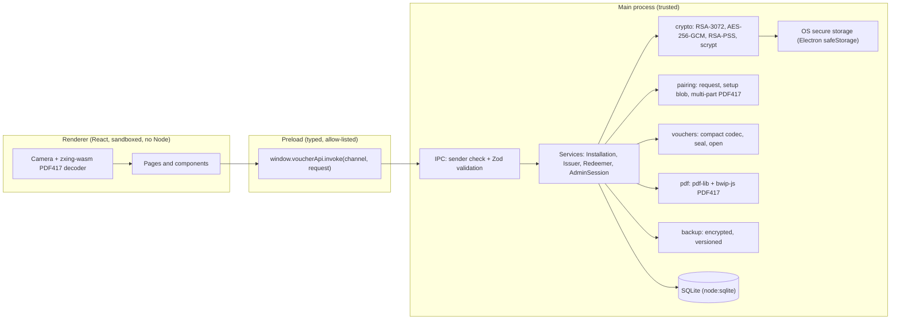

# Voucher Redeem

A completely offline desktop application for creating and redeeming vouchers. One computer runs as the **Issuer** and creates encrypted, digitally signed vouchers as branded PDFs. One computer runs as the **Redeemer** and scans, decrypts and validates them, preventing duplicate redemption and recording every redemption locally.

- No server, no cloud services, no internet dependency, no online accounts.
- No QR codes anywhere. **All** barcode communication (pairing, setup transfer and vouchers) uses **PDF417** (ISO/IEC 15438).
- Electron + TypeScript + React + Vite, SQLite, Zod, Vitest, Electron Builder.
- Windows 11 is the first target; the code is cross-platform and builds for macOS.

Further reading: [SECURITY.md](SECURITY.md), [CRYPTOGRAPHY.md](CRYPTOGRAPHY.md), [DATA-MODEL.md](DATA-MODEL.md), [TESTING.md](TESTING.md), [USER-GUIDE.md](USER-GUIDE.md).

## Contents

1. [Architecture](#architecture)
2. [Roles](#issuer-and-redeemer-roles)
3. [Installation and development](#installation-and-development)
4. [Production build and Windows packaging](#production-build-and-windows-packaging)
5. [Pairing](#pairing-instructions)
6. [Creating vouchers](#voucher-creation)
7. [Redeeming vouchers](#voucher-redemption)
8. [Global expiry](#global-expiry-behaviour)
9. [Backup and restore, key loss](#backup-and-restore)
10. [Scanner and camera requirements](#barcode-scanner-and-camera-requirements)
11. [PDF417 library choices](#pdf417-library-choices)
12. [Database location](#database-location)
13. [Security design](#security-design)
14. [Known offline limitations](#known-offline-limitations)
15. [Design decisions](#design-decisions)
16. [Troubleshooting](#troubleshooting)

## Architecture



```
src/
  main/        Trusted code: database/, crypto/, pairing/, vouchers/, pdf/, scanners/, backup/, ipc/, services/
  preload/     contextBridge API (channel allow-list only)
  renderer/    components/, pages/, hooks/, services/, styles/
  shared/      schemas/ (Zod), types/, constants/, utilities/
tests/         unit/, integration/, e2e/, helpers/
assets/        branding/, fonts/ (Noto Sans, SIL OFL)
migrations/    Versioned SQL migrations
scripts/       build-main.mjs (esbuild), dev.mjs
```

Layering rules:

- React components contain no cryptography. They call `window.voucherApi` and display results.
- Private keys, the database, files, PDF generation and all cryptography live in the main process. Private keys are never sent to the renderer.
- `main/services` is Electron-independent, so the whole flow is testable in plain Node (`tests/`).
- Barcode **decoding** runs in the renderer (WebAssembly, no network); decoded bytes are validated and processed in the main process. Raw camera frames are never stored or sent to the main process.

### Electron hardening

`contextIsolation: true`, `nodeIntegration: false`, `sandbox: true`, a narrow preload that exposes one function and an allow-list of channel names, `will-navigate` and window-open denial, `webview` denied, camera-only permission handler restricted to the app's own origin, all network requests blocked except the app's own `app://` origin, a strict Content-Security-Policy, and Electron fuses (`runAsNode` off, ASAR integrity on). Every IPC request is checked for a trusted sender and validated with a strict Zod schema before a handler runs. Production windows have DevTools disabled.

## Issuer and Redeemer roles

On first launch choose **Set up as Issuer** or **Set up as Redeemer** and set an administrator password. The role is locked. Changing it requires an administrator reset (see Backup and restore).

| Item | Issuer | Redeemer |
| --- | --- | --- |
| Key pair | RSA-3072 (own) | RSA-3072 (own) |
| Stores | Own keys, Redeemer public key, rolling codes, installation identifier | Own keys, Issuer public key, rolling codes, installation identifier, expiry, redemptions |
| Does | Creates vouchers, signs, encrypts for the Redeemer | Decrypts, verifies, redeems, audits |

## Installation and development

Requirements: Node.js 22.13 or later (the build uses the built-in `node:sqlite`, which is also available inside Electron), npm.

```bash
npm install
npm run dev          # builds the main process, starts Vite and launches Electron
npm run dev:issuer   # dev instance that opens straight into Issuer setup (port 5173)
npm run dev:redeemer # dev instance that opens straight into Redeemer setup (port 5174)
npm run issuer       # run a built app with --role=issuer (run npm run build first)
npm run redeemer     # run a built app with --role=redeemer
npm start -- --role=issuer
npm run typecheck    # strict TypeScript for main and renderer
npm run lint
npm test             # all unit, integration and e2e tests
npm run test:unit
npm run test:integration
npm run test:e2e     # simulated PDF417 pairing, issuing and redeeming
npm run verify       # typecheck + lint + tests
```

### Running Issuer and Redeemer on one machine

Production is one Issuer PC and one Redeemer PC, but for testing run `npm run dev:issuer` in one terminal and `npm run dev:redeemer` in another. In development (unpackaged) the single-instance lock is off, and when a role is given each instance uses its own profile folder, so databases, keys and settings never collide:

- Issuer: `VoucherRedeem-Issuer` inside the OS application-data folder (`%APPDATA%` on Windows)
- Redeemer: `VoucherRedeem-Redeemer`

With `--role=...` on a fresh profile the app skips the role choice and goes straight to that role's setup. With no role argument the normal role screen appears. The role argument never overrides a role already locked on an installation. Packaged builds keep the single-instance lock. To pair on one machine, use the image-import or camera option, or point the Issuer camera at the Redeemer's screen; the Redeemer can use *Use the camera instead* to read the Issuer's pairing barcode.

## Production build and Windows packaging

```bash
npm run build        # typecheck, bundle main/preload (esbuild), bundle renderer (Vite)
npm run package:win  # NSIS installer and portable build into release/
npm run package:mac  # DMG (macOS)
```

Packaging uses Electron Builder (`electron-builder.yml`). Migrations and fonts are copied to `resources/`. Build the Windows installer on Windows (or a CI Windows runner). Code-signing certificates are not included; add `win.certificateFile` or Azure signing settings for distribution. On macOS, code signing is required to run the packaged app because Electron fuses are enabled.

Everything is bundled, so the installed application needs no internet.

## Pairing instructions

Pairing is two-way and happens once per installation. Both computers need a camera (or use the image-import option with a photo or screenshot).

1. **Issuer**: set up as Issuer. A full-screen PDF417 pairing request is shown with a pairing reference. It contains only the Issuer's public key and a session UUID.
2. **Redeemer**: set up as Redeemer, then scan the Issuer's barcode. The Redeemer generates its own key pair, a random three-letter installation identifier and the rolling date codes, and builds an encrypted, signed setup payload.
3. **Redeemer** displays the setup as ordered PDF417 parts (typically 8). Use Previous/Next (or the arrow keys). Part X of Y is always shown.
4. **Issuer** presses *Next*, then scans the parts in any order. Captured parts are ticked; duplicates, altered parts and parts from another session are rejected with a message. When all parts are present, the checksum is verified, the payload is decrypted and pairing completes.
5. On the Redeemer, press *The Issuer has captured every part*. An administrator can show the parts again later (Pairing page) if needed.

Compare the key fingerprints on the two Pairing pages to confirm each computer is paired with the other.

## Voucher creation

Issuer, **Create Voucher**: enter the full name and amount. The standard amount is £4.00. Other amounts require administrator sign-in (the sign-in prompt appears on the same screen). Names are trimmed, limited to 60 characters and may not contain control characters. Amounts are parsed into integer pence (never floating point), must be above £0.00 and may have at most two decimal places.

The result screen offers **Save PDF**, **Print PDF** (opens the PDF in the system viewer so your normal print dialogue applies) and **Create another voucher**. The PDF is named `voucher_<uuid>.pdf`. The voucher is not stored after you leave the screen (only the most recent five PDFs are kept in memory for saving/printing).

## Voucher redemption

Redeemer, **Scan Voucher**: the screen is always in ready-to-scan mode for the USB barcode scanner (no text box needed). An optional camera section can be opened instead. The validation pipeline decrypts the voucher, verifies the Issuer signature, checks the installation identifier and rolling code, rejects future-dated vouchers, applies the global expiry and checks the database for the voucher UUID. A valid voucher shows a confirmation screen (name, amount, creation date, reference); **Redeem** inserts the record in a database transaction and shows a large success screen. **Cancel** records nothing.

This is "Option A": the operator honours the displayed amount manually. There are no balances, partial redemptions or monetary totals.

Results are colour-coded **and** use text and icons: green ✔ (valid), red ✖ (rejected), amber ⚠ (warning or operator action).

## Global expiry behaviour

An administrator sets **Global Voucher Expiry** (date, time and time zone) on the Redeemer. It is stored locally and is **not** in vouchers, so changing it affects every voucher immediately. A voucher is expired when the redemption time is later than the expiry. Until an expiry is set, redemption is blocked. Every change is confirmed and written to the audit log; expiry is never extended silently.

**Clock rollback protection:** the Redeemer records the latest time it has observed. If the system clock is more than 2 minutes earlier than that, redemption is blocked, a clock-integrity warning is shown, an audit event is written and the block stays in place until an administrator resolves it (Administration, Overview).

## Backup and restore

Administration, **Backup and reset**:

- **Create backup** requires the administrator password and a separate backup password (at least 12 characters, different from the administrator password). The backup (database rows, settings, role and key material) is encrypted in memory with AES-256-GCM using a scrypt-derived key and written as a `.vrbackup` file. No plaintext archive is ever written to disk. Integrity is verified by the authentication tag and an inner SHA-256 checksum.
- **Restore** replaces local configuration and data. It is allowed only on an unconfigured installation or one with the same role.
- **Reset** requires the administrator password and typing `RESET`. It deletes keys, settings and redemption records (the audit log is kept and records the reset). Create a backup first.

### Key-loss warnings

- If the **Redeemer private key** is lost, existing vouchers cannot be decrypted.
- Resetting the Redeemer **invalidates all vouchers issued for the previous key pair**; the Issuer must be reset and re-paired too.
- If the **redemption database** is lost, previously redeemed vouchers can be presented and accepted again unless a backup is restored. Back up regularly.
- If the administrator password is forgotten and no backup exists, a full reset is the only option.

## Barcode scanner and camera requirements

- **Issuer camera:** any webcam or built-in camera, used only during pairing. The live preview decodes PDF417 only, ignores other formats, ignores parts already captured, shows progress and is released as soon as pairing completes or you leave the capture step. Choose a camera when several exist.
- **Redeemer USB scanner:** a USB HID keyboard-wedge scanner with PDF417 enabled. It scans the Issuer pairing barcode and printed vouchers. The scanner must be set to a US keyboard layout (matching the computer) and to send **Enter (carriage return)** after each scan. Optional prefix/suffix characters are configured in Administration, Scanner test.
- **How scans are recognised:** keystrokes arriving faster than about 60 ms apart are buffered as one scan and completed by the terminator; slower typing is left alone. Incomplete scans, scans missing a configured prefix/suffix, and the same barcode repeated within 2 seconds are ignored. Scanning is disabled while a confirmation, success or rejection screen is displayed and resumes on return to the scan screen.
- **Voucher barcodes are digits.** Because a wedge scanner types characters, vouchers are printed as a PDF417 of decimal digits (numeric compaction) rather than raw bytes, so no byte can be mistaken for Enter or depend on the keyboard layout. The pairing barcodes are ASCII text.
- **Redeemer camera (optional):** the Redeemer keeps a camera fallback (open *Use the camera instead*) and image import. It is off by default and releases the camera when closed.
- **Scanner test (administrator, Redeemer):** shows a test PDF417 on screen; scan it with the USB scanner to confirm activity, PDF417 support and character fidelity. If the scanner adds a prefix or suffix it reports what it detected. The test never redeems a voucher and never shows voucher content.

## PDF417 library choices

- **Generation: `bwip-js`** (maintained, vector-friendly raw output). The application draws each module as a vector rectangle in the PDF, so printing stays sharp at any resolution.
- **Decoding: `zxing-wasm`** (maintained WebAssembly build of ZXing-C++ with PDF417 support). Selected because it decodes binary PDF417 reliably and runs offline in the renderer. Tests round-trip real symbols through the decoder.
- **PDF: `pdf-lib`** with `@pdf-lib/fontkit` and embedded, subsetted **Noto Sans** (SIL Open Font License, see `assets/fonts/OFL.txt`).

PDF417 is specified by ISO/IEC 15438.

### Capacity and layouts

A voucher must fit one symbol and carries two RSA-3072 values (a 384-byte wrapped key and a 384-byte signature), so it is about 860 bytes. This is dense. Layouts:

| Layout | Size | Row height | Module width (X-dimension) |
| --- | --- | --- | --- |
| Wallet (default) | 85.6 x 54 mm | 2 modules | about 0.24 mm |
| A6 landscape | 148 x 105 mm | 3 modules | about 0.36 mm |
| A5 landscape | 210 x 148 mm | 3 modules | about 0.51 mm |

The wallet card works with a good printer (600 dpi) and camera but is the least forgiving. **If printed vouchers do not scan reliably, choose A6 or A5** (Administration, Branding). Generation refuses a layout whose module width would fall below 0.19 mm. Use *Administration, Scanner and printer* to print a test page and try scanning it.

## Database location

SQLite file `voucher-redeem.db` in Electron's `userData` directory:

- Windows: `%APPDATA%\Voucher Redeem\voucher-redeem.db`
- macOS: `~/Library/Application Support/Voucher Redeem/voucher-redeem.db`

Private keys inside it are encrypted with the operating system's secure storage (Windows DPAPI, macOS Keychain). They cannot be read by copying the file to another computer or user account; use an encrypted backup to move an installation.

## Security design

See [SECURITY.md](SECURITY.md) and [CRYPTOGRAPHY.md](CRYPTOGRAPHY.md). In short:

- **Encryption protects confidentiality** of vouchers and the setup transfer.
- **Digital signatures verify that the paired Issuer created the voucher.**
- **The rolling date code validates the creation-date mapping.** It is a date check, not the primary protection.
- **The three-letter value is an installation identifier, not a password.**
- **Duplicate protection depends on the Redeemer's local database** (unique constraint on the voucher UUID).

## Known offline limitations

- A completely offline application **cannot independently guarantee that the operating-system clock is correct**. Rollback detection reduces risk but cannot prove the clock is right. Restrict who can change the system time.
- Losing the redemption database (without a backup) allows redeemed vouchers to be presented again.
- Losing the Redeemer private key means existing vouchers cannot be decrypted.
- Vouchers can be copied; the first valid presentation wins. Each voucher can be redeemed once, by whoever presents it first.
- There is one Issuer and one Redeemer. Several Redeemer computers cannot share redemption state.
- Printing opens the PDF in the system viewer; a temporary copy is created in the OS temp folder and deleted on exit.

## Design decisions

Unspecified items were resolved as follows:

- **SQLite:** Node's built-in `node:sqlite` (available in Electron) avoids native-module rebuilds and installer problems. SQL migrations in `migrations/` are applied by a small runner that records versions in `schema_migrations`.
- **Public key format:** base64url of the SPKI DER bytes (compact), validated as RSA-3072 with exponent 65537.
- **Wire format:** the descriptive envelope schema (`voucher-redeem-envelope`) is implemented and validated, but barcodes carry a compact binary form of it (magic `VR`, version, type, flags, key ID, then wrapped key, IV, tag, optional signature, ciphertext). This is what lets a voucher fit one PDF417. Voucher payloads are likewise packed (UUID as 16 bytes, amount as `u32`, timestamp as epoch milliseconds plus UTC offset); date and time strings are derived from those values so they cannot disagree.
- **Setup compression:** the setup JSON is deflate-compressed before encryption (the 366 rolling codes would otherwise need many more barcodes).
- **Setup signature:** the Redeemer signs the setup envelope. The Issuer verifies it with the Redeemer public key found inside the decrypted payload, which proves the sender holds the matching private key.
- **Password hashing:** scrypt (N=32768, r=8, p=1) with a random salt, from Node's `crypto`, chosen over Argon2 to avoid native modules.
- **Administrator sessions:** unlocked for 5 minutes of inactivity, with a 30-second lockout after five wrong passwords.
- **Custom amounts:** only an unlocked administrator may create a voucher whose amount differs from £4.00.
- **Rolling words:** drawn without repetition from a built-in word list by a secure shuffle, one distinct word per day including 29 February.
- **Reset:** deletes settings and redemption records; the audit log is retained.
- **Test mode:** the end-to-end flow is a Vitest test (`tests/e2e`) and is not part of any production bundle.
- **No debug flag for decrypted data:** the application never logs decrypted personal data, so there is nothing to enable.

## Troubleshooting

| Symptom | What to try |
| --- | --- |
| "Secure storage unavailable" | The OS cannot protect keys. On Linux install and unlock GNOME Keyring or KWallet. Windows and macOS need no action. |
| Camera permission denied | Allow camera access for the app in system privacy settings, then restart it. Use image import meanwhile. |
| Barcode will not scan | Improve lighting, avoid glare, hold steady, increase print quality, choose the A6 layout, print a test page. |
| "Corrupted or incomplete PDF417" | Rescan. Check the whole barcode is in view and unfolded. |
| Setup part rejected | Check it belongs to the current pairing session. Parts already captured are rejected as duplicates. If the final checksum fails, all parts are discarded; scan again. |
| "Wrong Redeemer computer" | The voucher was issued for another Redeemer key pair (for example after a reset). Reissue it. |
| "Invalid rolling date code" or "Incorrect installation identifier" | Issuer and Redeemer were not paired with each other, or one was reset. |
| "Redeemer clock integrity warning" | Check and correct the system clock, then resolve in Administration, Overview. |
| "Global voucher expiry not set" | Set it in Administration, Overview. |
| Forgot administrator password | Restore is not possible without it; reset the installation (a backup can only be restored after reset into the same role using the backup password). |
| Printed card too dense | Select A6 or A5 in Administration, Branding. |
| `npm run dev` fails with port 5173 in use | Close the other process using that port. The Redeemer dev instance uses 5174. |
| Scanner scans do nothing | Open Administration, Scanner test. Check the scanner sends Enter, has PDF417 enabled and uses a matching keyboard layout. |
| Scanner test shows extra characters | Enter the detected prefix/suffix in Scanner format and save. |
